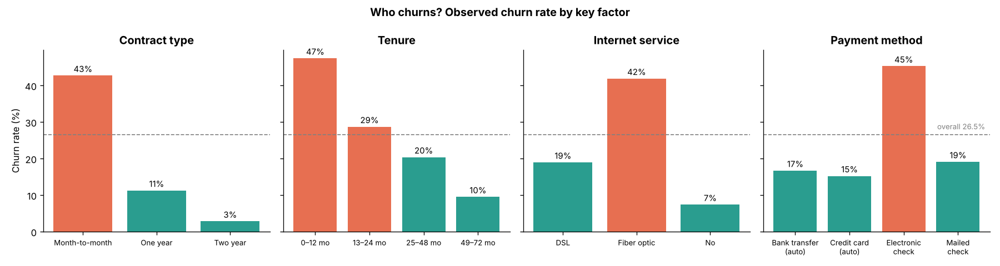
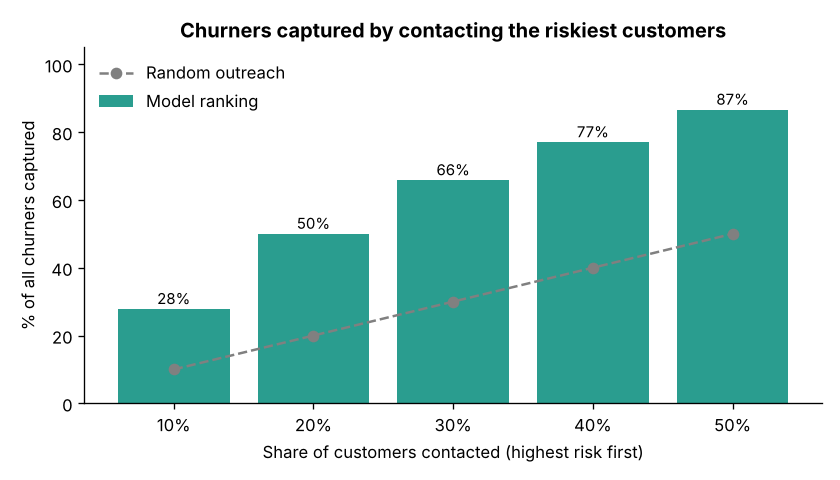
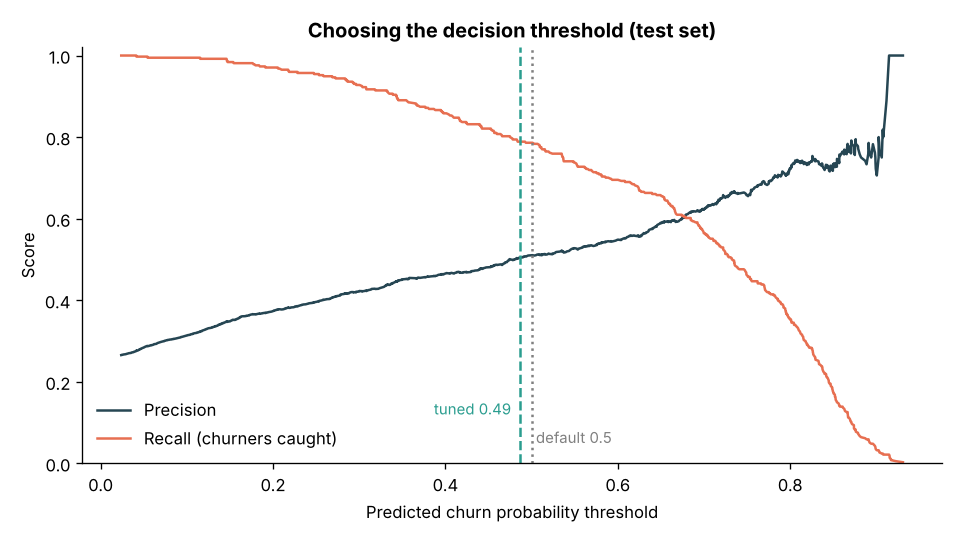
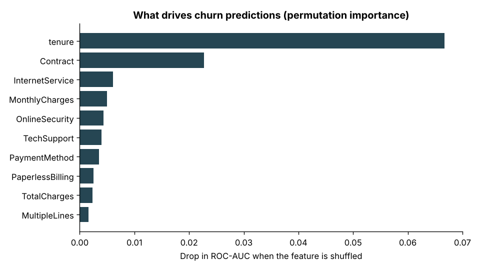

# 📉 Customer Churn Prediction

**A churn model for a telecom company that catches 79% of customers who are about to leave (up from 56%), packaged as a tested, reusable pipeline with an interactive Streamlit app.**




---

## 🎯 Business problem

About 1 in 4 customers (26.5%) leave each period. Keeping an existing customer is much cheaper than winning a new one, so the retention team needs a ranked list of customers who are likely to churn *before* they leave.

Missing a churner costs more than sending a retention offer to someone who would have stayed, so the model is optimized for **recall on churners** rather than raw accuracy.

---

## 📌 Results

| Model | Threshold | Recall (churners caught) | Precision | F1 | ROC-AUC | Accuracy |
|---|---|---|---|---|---|---|
| Baseline logistic regression | 0.50 | 0.56 | 0.66 | 0.60 | 0.84 | 0.81 |
| **Tuned logistic regression** | **0.49** | **0.79** | 0.51 | **0.62** | 0.84 | 0.74 |

*Evaluated on a held-out test set of 1,409 customers (374 churners).*

- **The tuned model catches 295 of 374 churners vs 209 for the baseline: 86 more customers flagged for retention.** The trade-off is more false alarms (precision drops from 0.66 to 0.51), which is acceptable when an offer costs much less than a lost customer.
- **Prioritizing outreach works:** contacting the riskiest **20%** of customers reaches **50%** of all churners, which is 2.5× better than random outreach.

| Lift chart | Threshold trade-off |
|---|---|
|  |  |

### What drives churn

| Factor | Highest churn | Lowest churn |
|---|---|---|
| **Contract** | Month-to-month: **43%** | Two-year: **3%** |
| **Tenure** | First 12 months: **47%** | 4+ years: **10%** |
| **Internet** | Fiber optic: **42%** | No internet: **7%** |
| **Payment** | Electronic check: **45%** | Auto-pay (card/bank): **15–17%** |

Permutation importance confirms **tenure** and **contract type** are the model's strongest signals.



### Recommended retention actions
1. **Convert month-to-month customers to annual contracts** with a first-year discount.
2. **Invest in onboarding during the first 12 months**, when churn risk is highest.
3. **Nudge electronic-check payers to auto-pay**, a low-cost change linked to roughly 3× lower churn.
4. **Investigate fiber-optic churn:** its churn rate is more than double DSL's, which may point to price or service-quality issues.

---

## 🧪 Methodology

1. **Data:** [Telco Customer Churn](data/Telco_churn.csv): 7,043 customers, 19 features (demographics, services, billing)
2. **Cleaning:** blank `TotalCharges` for new customers is converted to missing and imputed with the median
3. **Preprocessing pipeline:** `StandardScaler` for numeric features and `OneHotEncoder` for categorical ones, inside a scikit-learn `Pipeline` so training and inference stay identical
4. **Model comparison** ([notebook](notebooks/churn_analysis.ipynb)): Logistic Regression (recall 0.56), Random Forest (0.48) and XGBoost (0.52). Logistic Regression won on recall and is the most interpretable.
5. **Hyperparameter tuning:** `GridSearchCV` over regularization strength `C` and `class_weight` with 5-fold stratified CV. Every setting scored within 0.003 ROC-AUC of the others, so I used the **one-standard-error rule** to pick the simplest, most stable model (`C=0.01`, `class_weight='balanced'`).
6. **Threshold tuning:** the decision threshold is chosen on *out-of-fold training predictions* (no test-set leakage) as the highest threshold that still reaches 80% recall
7. **Evaluation:** recall, precision, F1, ROC-AUC, lift and permutation importance on the untouched 20% test set

---

## 🖥️ Interactive app

`app.py` is a Streamlit app where you enter a customer's contract, services and billing details. It returns a churn probability, a risk level (Low / Medium / High) and suggested retention actions.

```bash
streamlit run app.py
```

---

## ▶️ How to run

```bash
git clone https://github.com/1998-aish/churn-prediction-ml.git
cd churn-prediction-ml
pip install -r requirements.txt

python src/train.py     # tune, evaluate, save models/churn_model.joblib and regenerate charts
pytest -q               # run the test suite
streamlit run app.py    # launch the demo app
```

Use the saved model from Python:

```python
from src.predict import predict_one
predict_one({"tenure": 2, "Contract": "Month-to-month", "MonthlyCharges": 90.0, ...})
# {'churn_probability': 0.93, 'will_churn': True, 'risk': 'High'}
```

---

## 📁 Repository structure

```
churn-prediction-ml/
├── app.py                       # Streamlit demo
├── src/
│   ├── pipeline.py              # data loading + preprocessing/model pipeline
│   ├── train.py                 # tuning, threshold selection, evaluation, charts
│   └── predict.py               # load saved model and score customers
├── tests/
│   └── test_model.py            # data, model and prediction tests (pytest)
├── models/
│   └── churn_model.joblib       # trained pipeline + decision threshold
├── outputs/
│   └── metrics.json             # baseline vs tuned metrics, lift, top features
├── notebooks/
│   └── churn_analysis.ipynb     # EDA and model comparison (LR, RF, XGBoost)
├── data/
│   └── Telco_churn.csv
├── images/                      # charts used in this README
├── .github/workflows/ci.yml     # retrains the model and runs tests on every push
└── requirements.txt
```

---

## 🔭 Next steps

- Deploy the app on Streamlit Community Cloud
- Add SHAP explanations for customer-level reasons
- Estimate campaign ROI by combining churn probability with customer lifetime value

---

## 👩‍💻 Author

**Aishwarya Srivastava**: M.S. Data Science & Analytics, Arizona State University
[LinkedIn](https://www.linkedin.com/in/aish-sv123) · [GitHub](https://github.com/1998-aish)
