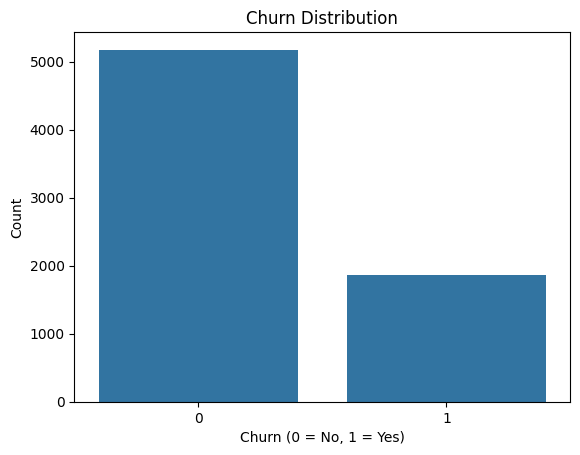
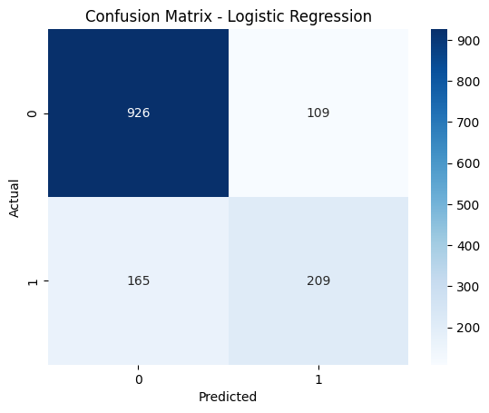
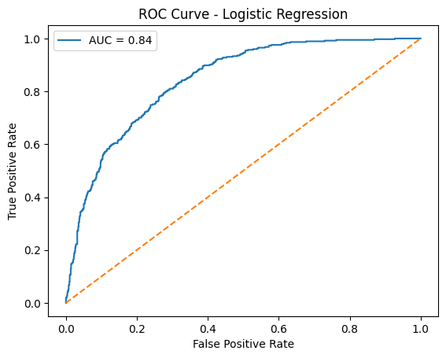
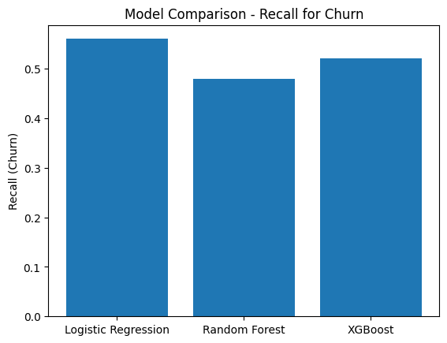

# Customer Churn Prediction

## 🚀 Project Overview
Losing customers is expensive for subscription businesses — it usually costs far more to win a new customer than to keep an existing one. This project builds machine learning models on the Telco Customer Churn dataset to **flag customers likely to leave**, so a retention team can reach out before they do.

Because missing a churner costs more than a false alarm, models are compared on **recall for the churn class**, not just accuracy.

---

## 📊 Dataset
The dataset contains 7043 customer records and 20 feature columns including:
- Demographics (gender, senior citizen, etc.)
- Service usage (Internet, Phone, Tech support, etc.)
- Billing information (MonthlyCharges, TotalCharges, etc.)
- Target column: **Churn**

---

## 🧹 Data Preprocessing
- Identified and handled missing values
- Converted TotalCharges to numeric
- Encoded categorical features using OneHotEncoder
- Scaled numeric features using StandardScaler
- Used `stratify=y` during train/test split to maintain churn ratio

---

## 🤖 Models Used

| Model | Accuracy | Recall (Churn) | F1 Score |
|--------|----------|----------------|----------|
| Logistic Regression | 0.806 | **0.56** | 0.60 |
| Random Forest | 0.784 | 0.48 | 0.54 |
| XGBoost | 0.798 | 0.52 | 0.58 |

✔ Since recall for class 1 (churn) is most important, **Logistic Regression** was chosen as the final model.

---

## 📌 Evaluation Metrics
- **Accuracy:** Overall correctness
- **Recall (Churn):** Ability to correctly identify churners
- **F1 Score:** Balance between precision and recall

---

## 📊 Visualizations

### Churn Distribution


---

### Confusion Matrix — Logistic Regression


---

### ROC Curve — Logistic Regression


---

### Model Comparison — Recall


---

## 📂 Project Structure
```
churn-prediction-ml/
├── data/
│   └── Telco_churn.csv          # Telco Customer Churn dataset
├── notebooks/
│   └── churn_analysis.ipynb     # EDA, preprocessing, modeling, evaluation
├── images/                      # charts used in this README
├── requirements.txt
└── README.md
```

---

## 🛠 Installation & Usage
```bash
git clone https://github.com/1998-aish/churn-prediction-ml.git
cd churn-prediction-ml
pip install -r requirements.txt
jupyter notebook notebooks/churn_analysis.ipynb
```

---

## 🔭 Next steps
- Tune the decision threshold and use class weighting to raise churn recall further
- Add SHAP explanations to show which factors drive churn for each customer
- Serve the model through a simple Streamlit app for interactive predictions

---

## 👩‍💻 Author
**Aishwarya Srivastava** — M.S. Data Science & Analytics, Arizona State University
[LinkedIn](https://www.linkedin.com/in/aish-sv123) · [GitHub](https://github.com/1998-aish)
